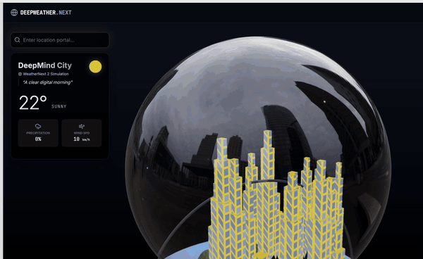
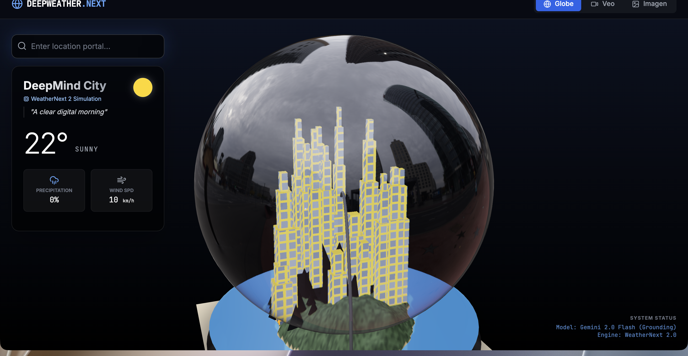
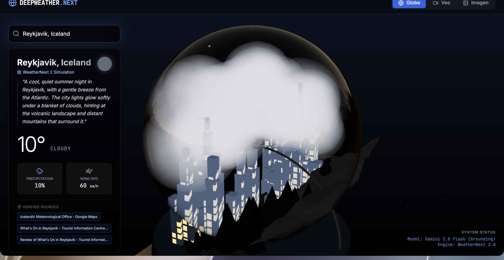

# DeepWeather Globe



A 3D weather snow globe powered by Gemini. Type any city — the globe rebuilds itself with procedural terrain, buildings, and weather effects pulled from real-time data via Google Maps grounding. Includes a Veo video generation studio.

## Quick Start

```bash
git clone https://github.com/AndrewVoirol/ais-deepweather-globe-studio.git
cd deepweather-globe-studio
npm install
npm run dev
```

Requires a Gemini API key. Create `.env.local`:

```
VITE_GEMINI_API_KEY=your_key_here
```

## How It Works

Search for any location. Gemini 2.5 Flash (with Google Maps grounding) returns weather parameters — temperature, condition, cloud cover, terrain type, building style, time of day. The 3D scene rebuilds: custom GLSL shaders light up building windows at night, FBM noise sculpts the terrain, particle systems drive rain/snow, and volumetric clouds drift through the upper hemisphere.





Switch to **Veo Studio** to generate videos with Veo 3.1 — text-to-video or image-to-video.

## Tech Stack

| Layer | Technology |
|---|---|
| Framework | React 19 + Vite |
| 3D Engine | Three.js + React Three Fiber 9 + Drei 10 |
| AI | Gemini 2.5 Flash, Veo 3.1 via `@google/genai` |
| Styling | Tailwind CSS 3 |
| Icons | Lucide React |
| Language | TypeScript |

## Features

- **Weather Globe** — Procedural terrain (island, coastal, mountain, inland), tiered buildings with custom window shaders, water plane, instanced trees
- **Weather Effects** — Snow particles, rain streaks, volumetric clouds — all GPU-driven with custom GLSL
- **Day/Night** — Full lighting transition with starfield, window illumination, and HDRI environment swap
- **Google Maps Grounding** — Real location data with verified source attribution links
- **Veo Studio** — Text-to-video and image-to-video generation with download

## License

MIT
